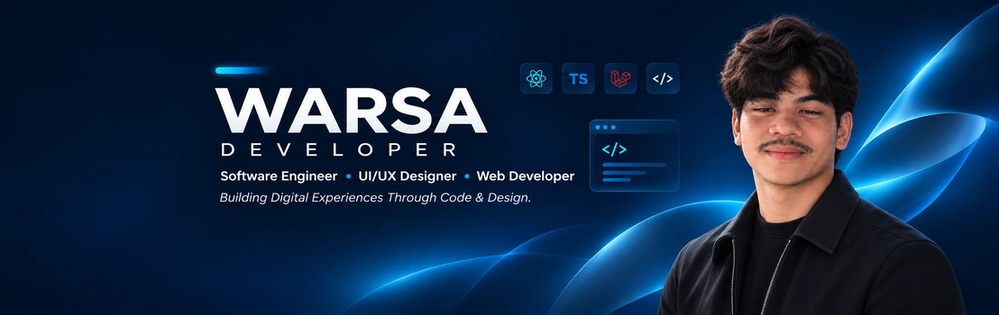

<div align="center">

<h1>WARSA Developer</h1>

<p><strong>Personal Portfolio — Fullstack Developer &amp; UI/UX Designer</strong></p>

<p>A modern, responsive personal portfolio built with React, TypeScript, and Vite.</p>

<p><a href="https://portofolio-warsa.my.id"><strong>Live Demo</strong></a> · <a href="https://github.com/warsaftharith/my-portofolio"><strong>Source Code</strong></a></p>

</div>

---



## Overview

WARSA Developer adalah website portofolio pribadi untuk memperkenalkan profil, keterampilan, pengalaman, proyek, serta layanan pengembangan website. Antarmuka dirancang responsif dengan navigasi dan tampilan yang dapat disesuaikan oleh pengunjung.

**Website:** [portofolio-warsa.my.id](https://portofolio-warsa.my.id)

## Features

- **Profile Hero & Banner** — tampilan profil dengan banner, avatar, informasi singkat, dan statistik.
- **Appearance Preferences** — pilihan tema terang, gelap, atau mengikuti sistem, serta pengaturan warna aksen.
- **Multilingual Interface** — pilihan bahasa manual dan mode otomatis mengikuti bahasa browser untuk bahasa yang didukung.
- **Adaptive Navigation** — navbar dan opsi dock yang menyesuaikan desktop maupun perangkat mobile.
- **Project Showcase** — bagian untuk menampilkan karya dan pengalaman pengembangan.
- **Service Pricing** — halaman `/pricelist` untuk melihat pilihan layanan.
- **First-Visit Tour** — pengenalan fitur dan navigasi untuk pengunjung baru.
- **Image-Aware Loading** — menyiapkan aset utama seperti banner dan foto profil sebelum tampilan utama dibuka.

## Tech Stack

| Area | Technologies |
| --- | --- |
| Frontend | React, TypeScript |
| Build Tool | Vite |
| Styling | Tailwind CSS, CSS |
| Animation | Framer Motion, Lottie React |
| Navigation | React Router |
| Icons | Lucide React, React Icons, Heroicons |
| Analytics | Vercel Analytics, Speed Insights |

## Run Locally

Requirements: Node.js and npm.

```bash
git clone https://github.com/warsaftharith/my-portofolio.git
cd my-portofolio
npm install
npm run dev
```

Buka alamat lokal yang ditampilkan oleh Vite (umumnya `http://localhost:5173`).

Build dan preview versi production:

```bash
npm run build
npm run preview
```

## Live Demo

Website dapat diakses langsung melalui:

### [https://portofolio-warsa.my.id](https://portofolio-warsa.my.id)

Halaman layanan: [View Price List](https://portofolio-warsa.my.id/pricelist)

## Repository

Source code: [github.com/warsaftharith/my-portofolio](https://github.com/warsaftharith/my-portofolio)

---

<div align="center">
  <sub>Designed and developed for WARSA Developer.</sub>
</div>
